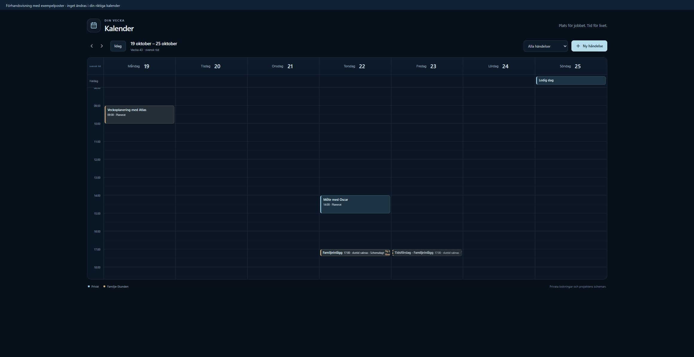

# Omnira Kalender — verifiering 2026-10-18

Status: granskningsbar lokal förhandsversion, inte driftsatt. Kalenderns egna kontroller passerar. Den bredare Windows-körningen är inte grön; helhetskörningen av det frysta granskningsunderlaget är avslutad och kräver fortsatt felbedömning.

## Underlag och avgränsning

Godkänd spec: `docs/superpowers/specs/2026-10-18-omnira-calendar-design.md`.
Godkänd plan och Native-metod: André, 2026-10-18T18:14:09Z.
Main vid start: `34d21cde97aa1c25a6d34a613657d8aee91f8591`. Integrerad aktuell main: `d3f9fcc1045026042f6bb9c0cd302ed0b7283127` genom egen branchmerge `019e6e9a36695014e8888cd000354aebd17006d7`; ingen kalendermerge till main.
Separat granskning: fryst `39c5c32e081c1401a39b164d9329bda03c484d91` mot main.
Verifierad produktcommit efter den enda TDD-fixomgången: `ff8d5e7a807e54d92bcfff469637991b7e8c6f6d`.
Fortsatt arbete ligger på `codex/omnira-calendar-implementation-20261018`; den ursprungliga arbetskopians produktkod hålls fryst för den långa helhetskörningen.

Kalendern har en gemensam användarägd lagring för privat möte/arbetsblock och läsprojektioner av verkliga projektkällor. Kalendern skapar ingen ny publiceringskö eller körningsrätt. Gantt kan senare läsa samma id, start/slut, projekt och workStatus; dess gränssnitt ingår inte.

## Slutkontroller efter granskning

| Kontroll | Faktiskt resultat |
|---|---|
| `vitest run lib/calendar lib/atlas/conversation/calendar-effects.test.ts lib/qa/calendar-navigation.test.ts --no-file-parallelism --testTimeout=30000 --hookTimeout=60000` | **80/80 PASS**, 14 filer, inga överhoppade. Riktiga lokala SQL-funktioner, ägarisolering, idempotens, samtidighet, båda inputSource-värden och oförändrade sociala köer/godkännanden. |
| `playwright test --config playwright.calendar.config.ts` | **17/17 PASS**, dator och mobil390px, datum/tider, auth-notifieringar, sena svar, utkast, återställning och källfel. |
| `tsc --noEmit --pretty false` | **PASS**, exit0 efter återanvändning av projektets redan installerade @remotion-beroende. |
| `vitest run lib/qa/{calendar-navigation,navigation-closure,vnext-nav-model,mobile-nav-contract,vnext-mobile-shell-nav,sidebar-project-visibility}.test.ts --no-file-parallelism` | **129/129 PASS** i sex navsviter (inklusive de två kalenderfallen). Exakta menyförväntningar uppdaterade för den godkända Kalender-posten på dator/mobil. |
| 33 obligatoriska QA-filer från `.github/workflows/atlas-project-isolation.yml` samt `lib/atlas/conversation` | **1095/1099 PASS**, 36 filer, 4 Windows-baselinefel nedan, inga överhoppade. De två tidigare 5s-timeouterna passerar med uttryckliga30s/60s-gränser. |
| Schema/migrationskontroller efter integration av aktuell main | **252/252 PASS**, inklusive35 guard-,76 schema-,133 säkerhets- och8 riktiga privata SQL-fall. Även ny hel TypeScript-körning PASS. Samma kalender-SQL oförändrad. |

Fulla loggar och JSON-resultat finns i planens lokala arbetsjournal `.superpowers/sdd/2026-10-18-omnira-calendar/`. De trettiotre filerna listas exakt i `review-isolation-selection.json`; samtliga fel finns i `review-isolation-failures.json`.

## Separat granskning och rättningar

En färsk granskare läste hela ändringen, källornas faktiska SQL, spec, plan och beslut. Inga Critical-fynd. Fyra Important-fynd accepterades och rättades i **en** TDD-omgång; ingen andra granskare eller omgranskningsloop användes.

1. **Auth utan ny serverprop:** prenumerera på riktiga Supabase-auth-notifieringar. Vid utloggning/kontobyte töms privata poster, formulär och projekt direkt; ägargenerationen ogiltigförklaras, läsningar avbryts och sena läs-/skrivsvar ignoreras. Skrivning spärras tills aktuell session och serverägare överensstämmer.
2. **Fördröjd sparning:** kvittot kan bara stänga den redigerare som initierade sparningen och läser om aktuell vecka. En senare redigerares osparade text behålls. Den sparande redigerarens fält är låsta medan dess skrivning pågår.
3. **Fel vid projektupptäckt:** en strikt ägarskapsfråga skiljer verkligt tom projektlista från fel. Privat kalender fortsätter fungera; projektkällor stängs och märks otillgängliga. Samma kontroll används i HTTP och interaktiv Atlas-dispatch.
4. **Exakta lagrade tider:** oförändrade tidskontroller behåller kända UTC-värden inklusive sekunder och båda förekomsterna av höstens upprepade timme. Ny tvetydig lokal inmatning avvisas fortsatt.

RED: 7/8 nya webbläsarfall och 2/3 accessfall misslyckades på de faktiska beteendefelen före rättning. GREEN: alla ingår i ovanstående godkända slutkörningar.

Två **Minor**-fynd skjuts upp, utan att sparade tider eller publiceringsrätt ändras:

- Utan köjobb visas redaktionellt approved/needs_review som generellt tidsförslag; etiketten bör senare skilja redaktionsstatus från kögodkännande.
- Vid höstens upprepade timme kan kollisionsgeometrin bli för smal för ett UTC-intervall som korsar klockans tillbakagång. Originalets UTC-tid och text bevaras; specialvisning för den timmen återstår.

Ägarens egna råa tabellskrivningar omfattas av RLS men kan kringgå den stödda klientens RPC-journal. Det bedöms som självmanipulation utanför det stödda API-kontraktet, inte åtkomst till andra ägares data. SECURITY INVOKER och ägargrants behålls enligt godkänd plan.

## Återstående bredare testfel

Dessa fyra fel är oförändrade Windows-baselinefel, inte PASS:

- `lib/qa/platform-credential-events.test.ts` — Settings S0 · platform_credential_events migration — append-only and server-only **RLS on, no policy, every client grant revoked, and the service role holds SELECT and INSERT only**.
- Samma fil — **touches no other object and carries no data statement**.
- Samma fil — **the search_path follow-up pins the append-only function's search_path, and does nothing else**.
- `lib/qa/youtube-project-oauth.test.ts` — youtube connection · the codebase, read — **the state is touched only by the OAuth module; the start route records it, the callback consumes it and alone exchanges a code**.

De tre första orsakas av att äldre kommentarstrippning inte hanterar arbetskopians CRLF. Samma parser över main:s kanoniska Git/LF-text innehåller inte det felaktigt matchade platform_tokens. Det sista jämför Windows `lib\\media\\youtube-oauth.ts` med POSIX `lib/media/youtube-oauth.ts`. De berörda gamla test-/SQL-filerna är oförändrade även mot aktuell maind3f9fcc. Inga äldre migrationer, säkerhetsundantag eller orelaterade produkttester har skrivits om för att få grönt.

Den separata hela projektkörningen startade på fryst39c5c32 med30s-test/60s-hookgränser, egen lokal testdatabas och SQL-opt-in avstängt där projektets andra fixturer kräver det. **Avslutad2026-10-18T19:46:16Z, exit1:**15319 totalt,13808 passerade,393 misslyckade,1114 överhoppade och4 väntande (pending) i671 filer. Ingen kalenderfil hade ett misslyckat test. Elva fel gäller kalenderns gamla menyförväntningar och är senare rättade/omkörda. Övriga helhetsfel är inte samlat frikända som baseline; de kräver fortsatt bedömning före drift. Alla393 fel är namngivna i [full-suite-resultatet](2026-10-18-omnira-calendar-full-suite.json). Kalenderintroducerade gamla menyassertioner som hittades där är rättade: elva förväntningar över fem gamla navfiler, utan ändring i deras övriga kontrakt. Samlad omkörning av sex navsviter129/129 PASS.

## Förhandsversion och manuellt prov

Draft-PR: https://github.com/Bumbi190/ai-operating-platform/pull/405.

Lokal förhandslänk på Andrés dator: `http://127.0.0.1:54413/calendar?week=2026-10-19&preview=1`.

Bannern anger tydligt exempelposter; detta är minnesbaserad testdata med det riktiga kalendergränssnittet. Den är ingen produktionsinloggning eller varaktig produktionskalender.

Brave: TEST · Kalenderprov skapades, laddades om, flyttades från måndag19okt09:00 till fredag23okt10:15 och laddades om igen med rätt tid. Titel och anteckning behölls. Vanliga tangentbordshändelser verifierade datum/tid; browserverktygets fill för date/time ändrade enbart DOM-värdet tills tangentbordshändelsen utlöste Reacts förändring. Det var en verktygsbegränsning; inget produktbeteende ändrades för den.

Produktionssessionen har endast lästs: André är inloggad och de befintliga Facebook-/Instagramkopplingarna finns kvar. Inga riktiga kalenderposter eller sociala scheman har ändrats där.

## Databas och driftsgrind

Ny CLI-genererad migration: `apps/web/supabase/migrations/20261018182213_user_calendar_v1.sql`.
Kanonisk Git/LF SHA256: `6bb10d31b39c3733e1646138cda08fc432135abdcfd00cfda6283b9e0d082c4e`.
Två användarägda tabeller: user_calendar_events och user_calendar_mutations, RLS, ingen anon/PUBLIC-åtkomst och inga privata service_role-grants.

**Ingen produktionsmigration, merge eller produktionsdeploy har utförts.** Kalendern är inte live. De sex befintliga Familje-Stunden-jobben och deras godkännanden lämnas orörda. Ny read-only produktionsobservation19:37Z visar de sex ursprungliga id:na queued/version1: två20okt15:00Z, två23okt18:30Z och två1dec19:30Z. Båda kalendertabellerna saknas och kalenderledgern har0rader. Metadata finns i planens production-preflight.json för senare jämförelse. Det automatiska Vercel-förhandsbygget för91940d5, dpl_8aNraNKiGLcU3SBdHYXA1qnAtPrk, **misslyckades faktiskt** före Next build vid migrationsgrinden: user_calendar_v1 saknas i produktionsledgern (fail-closed). Den ska inte kringgås. Ingen READY-förhandsdeploy eller DB-ansluten förhandslänk finns. GitHub Actions-obligatoriska gränskontroller har inte visat några körningar för detta draft-HEAD och får inte beskrivas som passerade.

Före drift kräver Task7 Andrés granskning av denna konkreta version, sedan exakt granskad migration, aktuell main/SQL-ledger, RLS/grants, merge och READY-deploy, samt metadatajämförelse för de sex ursprungliga socialjobben.

## Röst och kvarstående användarprov

Den gemensamma text-/voice-transkriptvägen är verifierad med riktiga lokala SQL-funktioner. **Ett faktiskt röstsamtal med mikrofon är inte genomfört.** InputSource=voice är inget ljudbevis. Även det autentiserade Atlas-provet via den driftsatta/DB-anslutna förhandsversionens textgränssnitt återstår; lokala formulärprov är inte samma sak.

Nästa användarprov: granska veckovyn och ett privat möte, därefter be Atlas skapa och flytta ett tydligt testmöte genom text och riktigt röstsamtal i DB-ansluten miljö. Gantt-gränssnittet planeras separat över samma modell.

## Integration med samtidig main-ändring

PR404 lade till den redan applicerade news-review-migrationens exakta källkod. Konflikter löstes endast i policy/fixture/registry: canonical148/enforced134, oförändrade frysta14/30-listor och175 registrerade tabellklassificeringar inklusive de två pending kalendertabellerna. Den verkliga170-namnsledgern innehåller news review men avvisas fortfarande för saknad user_calendar_v1; bara en tydligt hypotetisk171-namnsledger passerar i test. Inga gamla migreringsbytes ändrades. Kalenderns nya SQL är -text-pinnad med oförändrad SHA.

## Statuskontroll2026-10-19

PR405 är fortfarande öppen som draft, inte mergad, HEADb053687. Senaste commit gör etiketten för socialt innehåll utan köjobb tydligare; de ovan dokumenterade testkörningarna föregår den etikettändringen. Ny read-only produktionskontroll bekräftar att båda kalendertabellerna saknas och user_calendar_v1 har0ledger-rader. Ingen live-kalender eller godkänt faktiskt mikrofonprov påstås.
